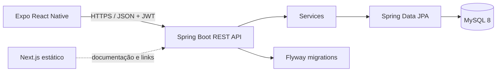

# Agregador de Investimentos

**Uma visão unificada da sua carteira.** API REST em Java 21 e Spring Boot para usuários, contas e posições em ações, acompanhada por um aplicativo mobile Expo.

**English:** A unified view of your portfolio. A Java 21 and Spring Boot REST API for users, accounts and stock positions, paired with an Expo mobile app.

[](https://openjdk.org/)
[](https://spring.io/projects/spring-boot)
[](https://expo.dev/)
[](https://www.docker.com/)
[]

> Screenshots: _adicione aqui capturas do dashboard e do app._

## Visão geral

O projeto reúne uma API de investimentos, um app React Native e um site de apresentação. A API oferece autenticação JWT, persistência MySQL com migrações Flyway, documentação OpenAPI e cálculo de valuation de carteiras usando o serviço de preços existente.

## Arquitetura



O backend mantém camadas explícitas de controllers, DTOs, services, repositories e entidades JPA. As rotas e formatos da API existentes são preservados.

## Estrutura

```text
backend/     API Spring Boot, migrations e testes
mobile/      Aplicativo React Native com Expo Router
website/     Site Next.js com exportação estática
docs/        Documentação complementar
docker-compose.yml
```

## Tecnologias

- **Backend:** Java 21, Spring Boot 3.5, Spring Security, JWT, Bean Validation, Spring Data JPA, Flyway, MySQL e springdoc OpenAPI.
- **Mobile:** React Native, Expo, TypeScript, Expo Router, TanStack Query e Zustand.
- **Website:** Next.js App Router, TypeScript e Tailwind CSS, com exportação estática.
- **Infraestrutura:** Docker Compose.

## Como executar

### Requisitos

Java 21, Docker com Docker Compose e Node.js (para mobile e website).

### Banco e backend

Na raiz do monorepo, inicie o MySQL:

```bash
docker compose up -d mysql
```

Em outro terminal:

```bash
cd backend
./mvnw spring-boot:run       # Linux/macOS
```

No Windows PowerShell use `.\mvnw.cmd spring-boot:run`. A API estará em `http://localhost:8080`; Swagger UI em `http://localhost:8080/swagger-ui.html`.

### Mobile

```bash
cd mobile
npm ci
npm start
```

Configure `EXPO_PUBLIC_API_URL` no arquivo `mobile/.env` conforme o dispositivo. Para simulador Android, use `http://10.0.2.2:8080`; para dispositivo físico, informe o IP local da máquina.

### Website

```bash
cd website
npm ci
npm run dev
```

Para gerar os arquivos estáticos: `npm run build` (saída em `website/out/`). Use `NEXT_PUBLIC_API_URL` durante o build para configurar os links Swagger.

### Testes do backend

```bash
cd backend
./mvnw test
```

## API

Todas as rotas existentes usam o prefixo `/v1`. As rotas protegidas requerem `Authorization: Bearer <token>`.

| Recurso | Rotas principais |
| --- | --- |
| Autenticação | `POST /v1/auth/login` |
| Usuários | `POST, GET /v1/users`; `GET, PUT, DELETE /v1/users/{userId}` |
| Contas | `POST, GET /v1/users/{userId}/accounts` |
| Valuation | `GET /v1/users/{userId}/valuation`; `GET /v1/accounts/{accountId}/valuation` |
| Ações e cotações | `POST, GET /v1/stocks`; `GET /v1/stocks/{stockId}`; `GET /v1/stocks/{stockId}/quote` |
| Posições | `POST, GET /v1/accounts/{accountId}/stocks` |

Veja a especificação completa no [Swagger UI](http://localhost:8080/swagger-ui.html) ou [OpenAPI JSON](http://localhost:8080/v3/api-docs).

## Roadmap

- [x] API REST com autenticação JWT e validação
- [x] Contas, endereços de cobrança, ações e posições
- [x] Valuation, migrations e Swagger/OpenAPI
- [x] Aplicativo mobile Expo
- [x] Monorepo organizado e site estático
- [ ] Publicar demonstração e adicionar capturas de tela

## Contribuição

Abra uma issue para discutir mudanças maiores e envie pull requests objetivos. Use mensagens de commit em inglês no padrão Conventional Commits, por exemplo `feat(mobile): add portfolio overview`.

## Links

- [Repositório no GitHub](https://github.com/CaioSouzx00/Agregador-de-Investimentos)
- [Documentação da API (Swagger)](http://localhost:8080/swagger-ui.html)

**Descrição curta para o GitHub:** Professional Investment Aggregator — Java 21 + Spring Boot REST API with real-time portfolio valuation, JWT security and React Native mobile app.
