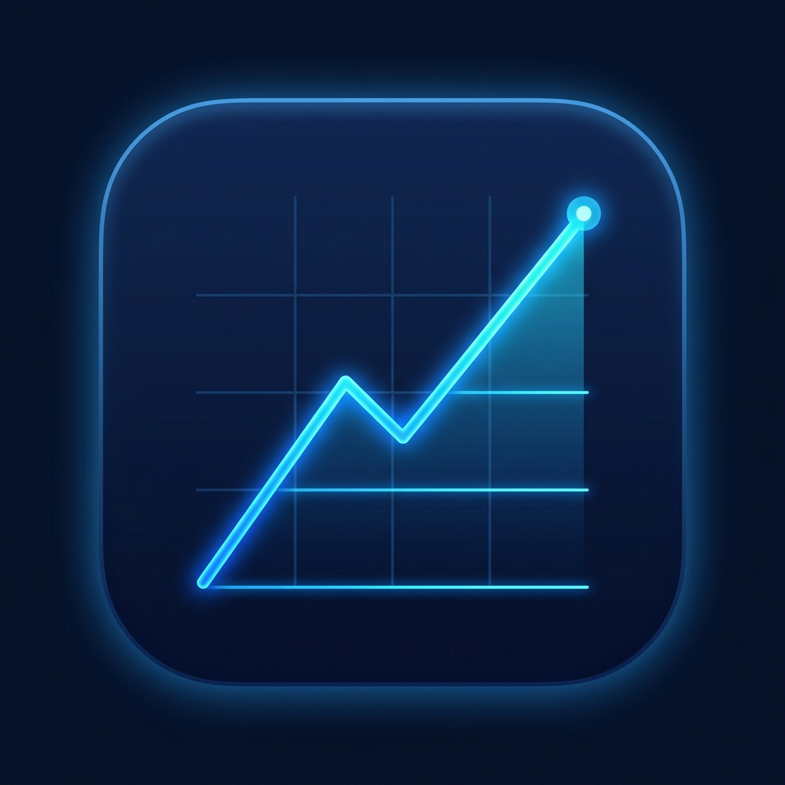

# 📱 Agregador de Investimentos — Mobile App

> Aplicativo mobile de alta criticidade e padrão fintech construído com **React Native**, **Expo SDK 52**, **Expo Router**, **NativeWind v4** e **Clean Architecture**.

<p align="center">
  
</p>

<p align="center">
  
  
  
  
  
</p>

---

## 🎯 Visão Geral

O **Agregador de Investimentos Mobile** foi desenvolvido sob os mais rigorosos padrões da indústria de tecnologia financeira (Fintech Level). Ele conecta-se diretamente ao backend Spring Boot para fornecer consolidação patrimonial em tempo real, cotações da B3, gestão multi-contas de custódia e detalhamento individual de posições com experiência do usuário fluida, feedback tátil (haptics) e design dark-mode first.

---

## 🏗️ Arquitetura do Projeto

O app adota uma **Arquitetura Baseada em Recursos (Feature-based Architecture)** combinada com princípios de **Clean Architecture** e **SOLID**:

```
src/
├── app/                                # Expo Router (Rotas tipadas e file-based)
│   ├── (auth)/                         # Grupo de Autenticação (público)
│   │   ├── _layout.tsx                 # Pilha de navegação com transição suave
│   │   ├── login.tsx                   # Tela de Login com validação Zod
│   │   └── register.tsx                # Tela de Cadastro com auto-login
│   ├── (app)/                          # Grupo Autenticado (protegido por Guards)
│   │   ├── _layout.tsx                 # Bottom Tabs personalizadas
│   │   ├── index.tsx                   # Dashboard principal (Valuation + Métricas)
│   │   ├── accounts/
│   │   │   ├── _layout.tsx             # Stack de Contas
│   │   │   ├── index.tsx               # Listagem de contas com busca
│   │   │   ├── create.tsx              # Abertura de conta e endereço de cobrança
│   │   │   └── [id].tsx                # Detalhes da conta, cotações e ativos
│   │   └── profile.tsx                 # Perfil, status do servidor e logout
│   ├── _layout.tsx                     # Provedores globais, Guards e Toasts
│   └── +not-found.tsx                  # Tela de 404
├── features/                           # Módulos por Domínio
│   ├── auth/                           # Schemas Zod, Services e Hooks de Sessão
│   ├── dashboard/                      # Hooks de Valuation Agregado e Cards Hero
│   ├── accounts/                       # Gestão de Contas e Modal de Associação
│   ├── portfolio/                      # Componentes de Posições e Ordenação
│   └── stocks/                         # Catálogo de Ações e Criação de Tickers
├── shared/                             # Componentes e Utilitários Reutilizáveis
│   ├── components/
│   │   ├── ui/                         # Design System (Button, Input, Card, Badge, Skeleton, etc.)
│   │   ├── feedback/                   # EmptyState, ErrorState, LoadingOverlay, ToastConfig
│   │   └── layout/                     # Header com suporte a Safe Area
│   ├── constants/                      # Chaves de armazenamento e configurações
│   ├── hooks/                          # Hooks transversais
│   ├── lib/                            # QueryClient e Adaptador SecureStore
│   ├── services/api/                   # Cliente Axios e Interceptors globais
│   ├── stores/                         # Zustand Auth Store com persistência segura
│   ├── types/                          # Tipagem TypeScript 100% estrita dos DTOs da API
│   └── utils/                          # Formatação de moeda BRL, datas, haptics e JWT
└── theme/                              # Paleta de cores oficial Fintech Dark
```

---

## 🎨 Design System (Fintech Dark Mode)

O aplicativo adota uma paleta intencional e premium voltada para serviços financeiros modernos:

| Token | Hex | Aplicação |
|---|---|---|
| `background` | `#0B1120` | Fundo principal da aplicação |
| `card` | `#111827` | Superfícies de cards e formulários |
| `card-hover` | `#1F2937` | Estado ativo/hover de elementos clicáveis |
| `border` | `#1F2937` | Bordas e divisores sutis |
| `primary` | `#3B82F6` | Ações principais e destaques da marca |
| `success` | `#10B981` | Lucro, valorização e feedback positivo |
| `danger` | `#EF4444` | Prejuízo, alertas e ações destrutivas |
| `warning` | `#F59E0B` | Avisos e estados pendentes |
| `foreground` | `#F8FAFC` | Texto principal com alto contraste |
| `muted-foreground` | `#64748B` | Labels, legendas e textos de apoio |

### Componentes de UI Implementados:
- **Button**: Variantes `primary`, `secondary`, `outline`, `ghost`, `danger` com feedback tátil e spinners de loading integrados.
- **Input / PasswordInput / SearchInput**: Foco estilizado, ícones contextuais e alternância de visibilidade de senha com haptics.
- **Card / CardHeader / CardContent**: Superfícies escuras com suporte a interação ao toque.
- **Badge / StatusBadge**: Indicadores com status de conectividade e badges categóricos.
- **Skeleton / SkeletonText / SkeletonCard**: Shimmer effect suave para loading states realistas.
- **EmptyState & ErrorState**: Ilustrações vetoriais, mensagens motivacionais em pt-BR e botões de ação e retry.
- **CurrencyText**: Formatação impecável da moeda brasileira (`R$ 15.420,50`) com `tabular-nums` e modo de privacidade (máscara de saldo).
- **PercentageText**: Indicadores dinâmicos de alta/baixa com ícones contextuais.
- **BottomSheet**: Modal deslizante com handle de arraste e animações nativas Reanimated.
- **Toast Customizado**: Notificações flutuantes contextuais integradas aos interceptors.

---

## 🔒 Segurança e Gestão de Estado

1. **Persistência Segura**: Os tokens JWT e dados de sessão são persistidos utilizando o `expo-secure-store` no iOS/Android, garantindo criptografia em nível de hardware (Keychain no iOS e Keystore no Android).
2. **Axios Interceptors Robustos**:
   - Injeção automática do cabeçalho `Authorization: Bearer <token>`.
   - Interceptor de resposta com detecção imediata de status `401 Unauthorized`, efetuando logout automático, limpeza de cache e aviso visual via Toast.
   - Tratamento de ausência de conexão e mapeamento de mensagens de validação da API.
3. **TanStack Query v5**:
   - `staleTime` de 2 minutos e `gcTime` de 10 minutos.
   - Retentativas inteligentes que ignoram erros de negócio (401, 403, 404, 409).
   - Invalidação automática de cache ao registrar novas contas ou posições de ações.

---

## 🚀 Como Executar o Projeto

### Pré-requisitos
- Node.js (v18+)
- Backend Spring Boot em execução na porta 8080 (http://localhost:8080)
- Dispositivo móvel com o aplicativo **Expo Go** instalado ou Emulador Android / Simulador iOS.

### 1. Instalação das Dependências
```bash
npm install
```

### 2. Configuração de Ambiente
Copie o arquivo de exemplo de ambiente:
```bash
cp .env.example .env
```
> **Nota para Emulador Android ou Dispositivo Físico:**
> - No emulador Android, aponte `EXPO_PUBLIC_API_URL=http://10.0.2.2:8080`
> - Em dispositivo físico na mesma rede Wi-Fi, aponte `EXPO_PUBLIC_API_URL=http://<IP-DO-SEU-PC>:8080`

### 3. Iniciar o Servidor de Desenvolvimento
```bash
npm run start
```

Ou execute diretamente na plataforma de preferência:
```bash
npm run android   # Para abrir no Android
npm run ios       # Para abrir no iOS
npm run web       # Para testar no navegador
```

### 4. Validação de Tipos (Strict Mode)
```bash
npm run type-check
```

---

## 📡 Endpoints Consumidos

| Método | Endpoint | Descrição |
|---|---|---|
| `POST` | `/v1/auth/login` | Autenticação e emissão do JWT |
| `POST` | `/v1/users` | Registro de novo usuário |
| `GET` | `/v1/users/{userId}` | Consulta de dados do perfil |
| `GET` | `/v1/users/{userId}/accounts` | Listagem de contas do usuário |
| `POST` | `/v1/users/{userId}/accounts` | Criação de conta e endereço de cobrança |
| `GET` | `/v1/users/{userId}/valuation` | Valuation total da carteira do usuário |
| `GET` | `/v1/accounts/{accountId}/valuation` | Valuation em tempo real da conta |
| `GET` | `/v1/accounts/{accountId}/stocks` | Listagem de posições mantidas na conta |
| `POST` | `/v1/accounts/{accountId}/stocks` | Associação de ativos à conta |
| `GET` | `/v1/stocks` | Catálogo de ativos disponíveis |
| `POST` | `/v1/stocks` | Cadastro de novos ativos no catálogo |

---

## 🏆 Padrões de Qualidade (Staff / Principal Level)

- **Zero `any`**: Tipagem 100% estrita em todos os requests, responses, hooks e stores.
- **Acessibilidade**: Labels, hints e roles em todos os botões e campos de entrada de dados.
- **Experiência do Usuário (UX)**: Haptic feedback em interações-chave, pull-to-refresh em todas as listas, e skeletons contextuais evitando layout shifts (CLS).
- **Tratamento de Edge Cases**: Estados de tela vazia (empty states) elegantes e recuperação automática contra falhas de rede.
